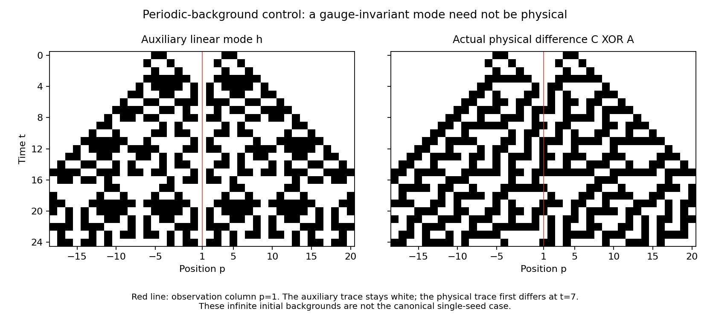

# Divided-difference observers: exact physics and an all-time warning

**The canonical Rule30 center problem remains open. The finite-background
observer conjecture is neither proved nor refuted here.** This checkpoint
proves a limitation of a proposed weakening, and supplies exact algebra and
frontier tools for keeping the original assumptions in the next proof.

The core module is proposed in [PR26](https://github.com/WolframInstitute/Rule30PrizeKit/pull/26),
head a7982fcddc8d8e66a57d951d6a7fbb01c809a30d. It changes only the new383-line
module, its public import and a catalog row. The saved PR head/body/files,
fork branch and raw-source readbacks agree. The earlier
[571 distinct canonical-pair experiments](../20261025-source-observer/REPORT.md)
remain finite evidence, not a universal theorem.

## What is proved, for every time

The [core Lean module](work/Rule30DividedDifference.lean) proves all of this:

1. Every local divided-difference gauge represents the **actual** nonlinear
   pair difference for every pair of initial configurations and every time
   (`Front.actual_difference`). There is no approximation in that identity.
2. Recombining A with an arbitrary auxiliary linear mode h has an exact
   quadratic error, `h_center AND (delta_right XOR h_right)` (`curvature`).
   The arbitrary auxiliary mode need not be an actual physical difference.
3. For A(p)=[p mod3=1] and B(p)=[p mod3=2], the backgrounds merge to all black
   after one step and vacuum after two (`backgrounds_vacuum`).
4. For **every integer k>=1**, set h initially black at only
   `-3k-2,-3k-1,3k+1,3k+2`. It is finite, nonzero at its leftmost source,
   and initially supported inside A XOR B (`finite_mode`, `source_bit`,
   `source_left`, `initial_subset`). Its observation at column1 stays white
   at **every time and under every local gauge** (`unobservable`).
5. These backgrounds have **no left bound**, proved for every proposed
   bound (`backgrounds_no_left_bound`). They are not finite initial rows.
6. For arbitrary actual backgrounds vanishing below lo, an auxiliary mode
   with left edge lo keeps edge lo-t for every time and every local gauge
   (`Front.mode_left_edge`). This is a frontier statement, not a proof that
   the frontier affects the center.

The counterexample is uniform in time, source separation and the entire
spacetime gauge. After time two, its auxiliary mode is an additive Rule150
reflection mode. This is an auxiliary equation inside genuine Rule30
backgrounds, not a claim that Rule30 itself equals Rule150.

For k=1, the initial actual recombination C=A XOR h agrees with that linear
description for three steps. It differs at time4, position-5, and its center
at column1 first differs at time7. The two explicit divergence controls are
also checked through Lean's kernel (`recombination_is_not_physical`,
`actual_center_diverges`). The diagram was independently generated and
visually inspected. Its red line is the observation column, not the center
of the canonical single-seed evolution.

## Why this changes the next proof attempt

Keeping the exact local Rule30 coefficient formula is insufficient if one
drops the initial support geometry. Eventual vacuum, initial support inside
the actual difference, and all local gauge identities do not by themselves
make an auxiliary mode physical or observable. The example satisfies all
three, yet is invisible forever. It does **not** satisfy the original
left-bounded/finite-background hypotheses.

For the canonical time-shift pairs, the actual farther-left edge is a black
cell of one background, white in the other, with both backgrounds white
strictly farther left. That geometry must be retained. The checked frontier
lemma preserves its expanding boundary; proving that its effect cannot stay
hidden at the center is still missing. Neither an isolated path nor the
frontier lemma establishes non-cancellation of the full source sum.

## Validation and exact scope

Core Lean4.35.0, no Mathlib in the catalog module. At current verifier pin
0090056412733accaa27643d3cbbf982104f2251, both the research source and the core
port passed the **unchanged official checker**, with all11 headline checks
and full kernel replay of185 declarations, including generated declarations.
No new axioms. These are the **same185 declarations** under two namespaces;
intermediate150/180-declaration checks are not counted again. The final
research build log is empty. The first cold catalog build and full replay
completed in47.8seconds with1.86GB peak owned RSS; the final185-declaration
incremental check completed in7.2seconds. The cold run had180 declarations
before the final actual-pair representation theorem was added.

The coefficient identity has512 independent Boolean controls. Eight
representative family members were independently simulated through time128;
their gauge wedges vanish and their actual recombined traces diverge. These
finite controls support implementation checking; they are not premises in
the unbounded Lean proof. All final guarded jobs terminated normally. Failed
imports/build attempts and intermediate proofs are retained as such.

## A parity detour that did not produce a new invariant

The earlier conservation classification was integer-valued, so F2-valued
densities were checked separately. At every window width1..10, finite cyclic
constraints leave exactly the constant-plus-shift-coboundary space. An
independent scalar implementation matched all saved constraint bases on
16,382 ring states and checked the trivial-space dimensions and orthogonality.
This rules out additional F2 densities at those widths. It is **not** an
arbitrary-width theorem or a prize result. Do not spend another search merely
increasing the width without a new structural reason.

The public snapshot still contained41 entries with no new or changed entry
at19:12UTC. No unverified external theorem was adopted. No new prize essay
was submitted, and no actual-computer settings were changed.
