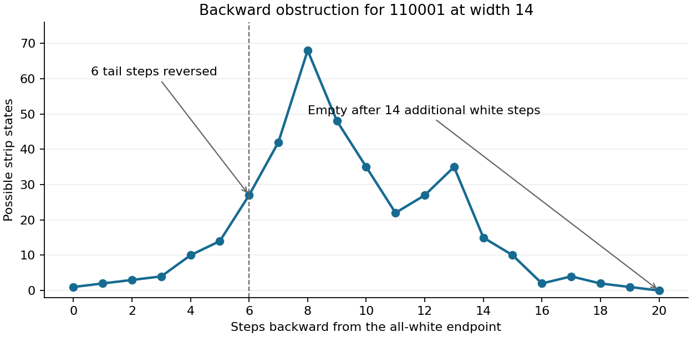

## Exact claim and scope

Rule 30 updates a cell by `a XOR (b OR c)`, where a, b, c are its left neighbor,
itself, and its right neighbor. Prize Problem 1 asks whether the center column
from one black seed is eventually periodic. The result here rules out certain
periodic words; it does not answer that question in full.

```wl
Clear[rule30Step];
rule30Step[row_List] := Module[{p = Join[{0}, row, {0}]},
  Table[BitXor[p[[j]], BitOr[p[[j+1]], p[[j+2]]]], {j, Length[row]}]];
rule30Rows = NestList[rule30Step,
  Join[ConstantArray[0, 100], {1}, ConstantArray[0, 100]], 100];
ArrayPlot[rule30Rows, ColorRules -> {0 -> White, 1 -> Black}, Frame -> False]
```

```wl
Take[rule30Rows[[All, 101]], 50]
```

For each of the sixteen Boolean words u of length six that begin and end in black,
and every r>=74, no column of a configuration with a leftmost black cell eventually
repeats `0^r u`. The transient, column, and initial configuration size are unrestricted.
This includes every column of every nonzero finite starting configuration and the
single-seed center.

The formal headline in **this notebook source** is
`Rule30Submission.no_six_bit_core`. Its hypothesis is membership in the explicitly
listed sixteen cores. The modular catalog separately combines these results with
the earlier five-tail proof and a rotation/decomposition theorem to cover **all**
tails of length at most six. That larger wrapper is not claimed as a theorem of
the standalone environment embedded here.

Some concrete words overlap earlier certificates. Global novelty is not established.
No full Rule 30 Prize problem is solved, and the alternating period remains open.

```wl
sixCoreWords = IntegerString[#, 2, 6] & /@ Range[33, 63, 2];
Grid[Partition[sixCoreWords, 4], Frame -> All]
```

## A finite obstruction proves infinitely many exclusions

The earlier white-pulse theorem forces a hypothetical periodic column's right
neighbor to be white during the early part of its long white run. A nearby black
cell would reach that neighbor too soon. Consequently a sufficiently wide strip
must be entirely white at every period start.

Start at that all-white endpoint and calculate predecessor sets backward, allowing
both right-boundary inputs at every step. If the predecessor set becomes empty
after the tail and N preceding white steps, no actual strip can realize that block.
The generic backward-vacuum theorem then excludes every `0^r u` with

    r >= max(N, 10*length(u)+11, K+9*(length(u)+1)).

This does not extrapolate from finitely many padding lengths. The fixed terminal
block is present in every longer white-padded word, while the analytic theorem
supplies the all-white endpoint for every sufficiently large r.

For the basic six-bit certificates, width fourteen is sufficient and the common
bound is 77. The largest case, `110001`, needs only fourteen preceding white steps
in its backward calculation. Its largest stored predecessor set has 68 states;
the kernel's completeness checks still cover all 16,384 strips and both right inputs.



## Endpoint refinements give the bound 74

Two smaller endpoint-conditioned calculations sharpen the common bound. They
retain only white-phase states in a closed white-driven set, intersect backward
predecessors with forward tail states, and force the neighboring bit at every
white phase. The effective OR boundary would therefore be periodic, contrary to
the uniform masked Jen theorem.

The `110001` refinement uses width twelve and fourteen backward white steps; its
analytic width bound is `12-1+9*(6+1)=74`. The `111101` refinement uses width ten
and gives the sufficient bound 72. Every other six-bit core already has a bound
at most 74, so the common sixteen-core bound is 74. No optimality is claimed.

## Independent computations

A cellwise Boolean implementation independently reconstructed every basic
predecessor set, covering 889,216 transition cases. Three negative controls retain
vacuum predecessors. A second cellwise check validates the endpoint sets,
forward images, and forced bits, and rejects an incorrect terminal bit.

Wolfram's free remote evaluator (15.0.1) independently encoded all sixteen basic
finite obstructions as Boolean satisfiability problems. Every positive case was
UNSAT; removing one required white step from the largest case was SAT. The exact
code and returned outputs are archived under `evidence/wolfram/`. These are
exploratory Wolfram computations, not a prize-verifier verdict.

## Formal proof

The following cell embeds every research dependency of the sixteen-core proof.
It imports only modules already present in the pinned kit, plus the required
`Rule30PrizeKit` root. It does not depend on files from an unmerged contribution
branch. The modular proof and local kernel-check reports are supplied separately.

The Wolfram/LeanLink cells evaluate the included proof and display the module's
kernel replay below. A successful local replay checks every declaration of that
module. The prize verifier evaluates the notebook again after submission.

```wl
Needs["Wolfram`LeanLink`"];
$Rule30PrizeKit = Environment["RULE30PRIZE_KIT"];
If[!StringQ[$Rule30PrizeKit] || !DirectoryQ[$Rule30PrizeKit], Abort[]];
```

```wl
rule30Submission = LeanImportString[@@LEAN_SOURCE@@, "ProjectDir" -> $Rule30PrizeKit];
```

```wl
sixCoreTheorem = rule30Submission["Rule30Submission.no_six_bit_core"];
sixCoreTheorem["TypeForm"]
sixCoreTheorem["Axioms"]
rule30KernelCheck = sixCoreTheorem["KernelCheck"]
```

## Limits and references

This is not a classification of every tail or every periodic word. No statement
about equal limiting frequencies or computational lower bounds is proved. The
notebook headline is the sixteen-core partial result; the complete length-at-most-six
result is a separate modular catalog theorem.

- [Rule 30 Prize kit](https://github.com/WolframInstitute/Rule30PrizeKit).
- `Rule30WhitePulseResearch`, `Rule30BackwardVacuumResearch`, and
  `Rule30RestrictedBackwardTubeResearch` in the contribution.
- The preceding essay, *Infinite exclusions and an arbitrary-tail reduction for Rule 30*.
- [Official agent workflow](https://www.wolframcloud.com/obj/rule-30-prize/Agents/skill.md).
