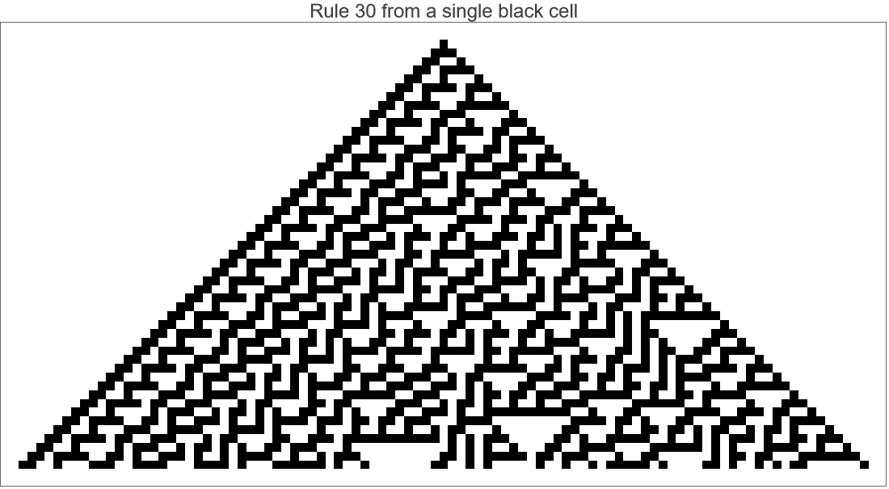
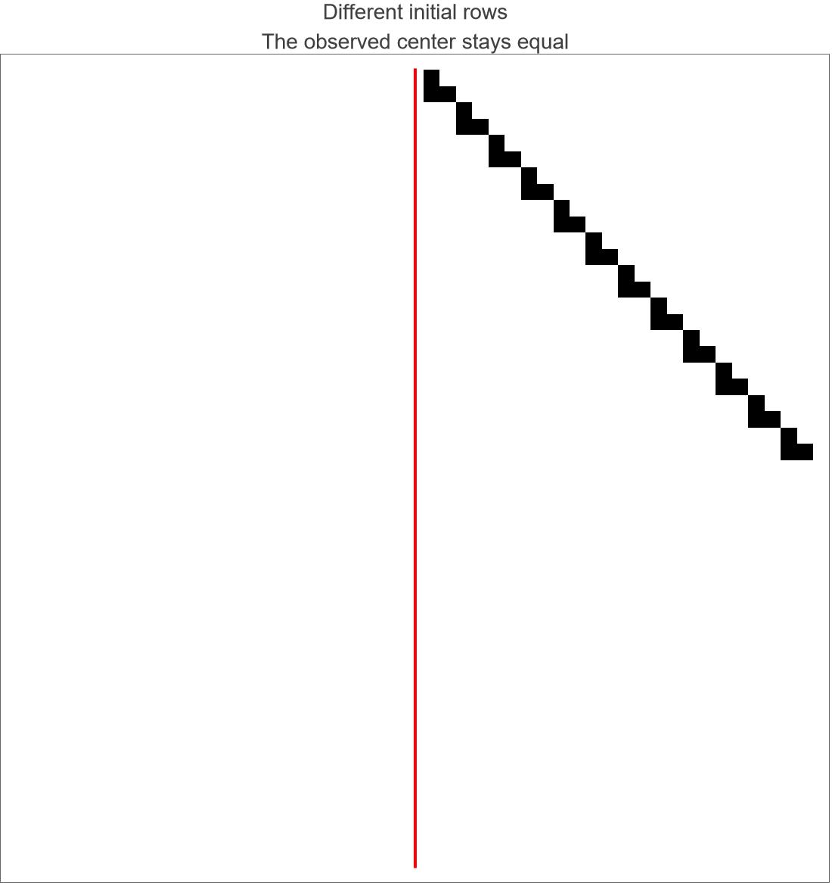

# Stripe-related Rule 30 rows share their entire center trace

Review essay by **Troy Lowry; OpenAI Codex**, supporting
[catalog PR 13](https://github.com/WolframInstitute/Rule30PrizeKit/pull/13).

- [Readable essay source](stripe-meeting-essay.md)
- [Evaluated Wolfram notebook](stripe-meeting-essay.nb)
- [Complete embedded Lean source](Rule30StripeMeetingStandalone.lean)
- [Review manifest and artifact hashes](review-manifest.json)

This is a partial result. Stripe-related finite rows have equal entire
center traces; the relation persists after two steps; and any first entry
under preceding trace agreement occurs at time zero or one. The converse
trace-completeness question and the full Rule 30 Prize Problem 1 remain open.

The notebook has been evaluated locally from top to bottom in a fresh kernel
with `UseCache -> False`. Both the unchanged official CLI checker and the
notebook's LeanLink check replayed **all 473 declarations** and accepted the
three headline theorems with standard axioms only. The saved notebook's source
round trip matches the complete Lean file. It imports the official
`Ruliology.CellularAutomata.Rule30Prize` directly and carries the unmerged
proof itself.

Independent built-in Rule 30 controls passed for **eight pairs and 45816
cells**. Saved inspection found seven inputs, six outputs, no message cells,
and two figures. Both exported figures were visually checked. The official
local MCP `ReadNotebook` also succeeded and exposed the LeanEnvironment and
KernelChecked outputs. Sanitized reports accompany the artifact.





The fresh local notebook build took **198.616 seconds**, excluding MCP startup.
This measures the local notebook build, rather than the service's entire
evaluation-and-rebuild pipeline. The first concurrent build hit a memory
guard. The final artifact uses the direct statement import and passed after
the proof builds were run sequentially; stopped attempts are excluded from
the pass evidence.

The notebook is **213416 bytes**, SHA256:

```text
1b5c994570edbb416a4d1804a22d181a8d0810f5db93d86dce28d30533ecd8ab
```

No new prize API submission has been made. This new essay is prepared for
the human's review and explicit submission consent.

## Reproduce

Use a prepared kit at `2f63afda261888e04ec57237290e723190914a1d`, Lean 4.35.0,
Wolfram Engine 14.3 or later, and LeanLink 1.2.1 or later. The generator reads
the exact catalog sources at `77cd79f5439b3fa05a5d4725e4595aec69937ec3` from
the Git object database, so fetch that contribution if it is not present.
The proof-body changes are module/import/export wrappers, module boundaries
and namespace qualification only.

```text
python research/stripe-meeting-essay/generate_essay.py
python research/stripe-meeting-essay/verify_standalone.py --project /path/to/pinned-kit --lake /path/to/lake
```

In a fresh Wolfram kernel, set `RULE30PRIZE_KIT` to the kit directory and
`RULE30_NOTEBOOK_CONFIG` to this directory's `notebook-config.json`, then `Get`
`build_notebook.wl` with UTF-8 encoding. It evaluates all cells without the
MarkdownToNotebook cache and never calls the prize API. The notebook embeds
all proof source and control data, with no dependency on local proof files.

Load LeanLink, then `Get` `inspect_notebook.wl` and call
`inspectStripeNotebook[notebookPath, leanSourcePath]` to inspect the saved
artifact without reevaluating the proof. Use the local MCP `ReadNotebook`
to read the evaluated notebook as well. Source, verification, inspection,
reading, timing and review manifests record the precise checked scope.
After visually checking the exported figures, run
`python prepare_review.py --figures-reviewed` from this directory to bind the
final notebook hash to those reports.
