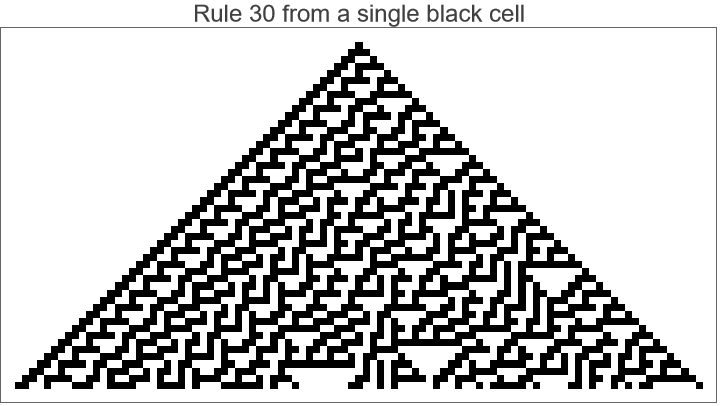
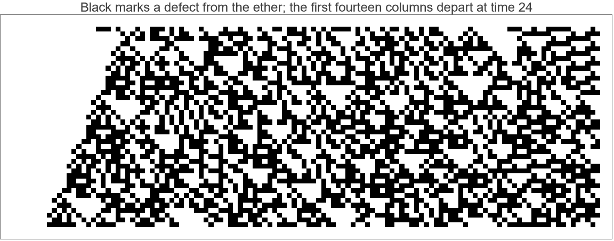

# Review copy: white-tail ether erosion

Prepared for Troy Lowry, 2026-10-24. Prize API submission awaits approval.

The [evaluated notebook](white-tail-erosion-essay.nb) contains the full proof,
computations and their outputs. The [essay source](white-tail-erosion-essay.md)
and [complete Lean source](Rule30WhiteTailErosionStandalone.lean) are also
available. The notebook carries all proof source and computational data; it
imports only modules in reference kit `2f63afda261888e04ec57237290e723190914a1d`.

If a Rule 30 right half has a period-three ether boundary from time T and
is white beyond W at T, then every prefix 1..k departs from the matching ether
by `T + 3 max(W + 12 - k, 0) + 6`, for every k>=1. Column one departs from
the matching ether arbitrarily late. All widths, phases, transients and finite
initial right words are covered.

This extends Luis Perez Morales and Claude's [PR #10](https://github.com/WolframInstitute/Rule30PrizeKit/pull/10),
whose finite-perturbation hypothesis requires a rightmost ether defect. A white
tail has infinitely many ether defects. Our [PR #11](https://github.com/WolframInstitute/Rule30PrizeKit/pull/11)
replaces that premise with a bounded defect witness and uses their unchanged
front certificate and potential. Their proof remains credited to them.

**Problem 1, exclusion of a period-three center, and erosion for arbitrary
infinite right sides remain open.** This is a partial result.

The exact embedded source passes the unchanged official checker: all 182
declarations, including the dependency and three headline aliases, pass full
kernel replay with standard axioms. The notebook's own fresh LeanLink replay
also passes all 182. Saved-source round trip, saved computation outputs and
figure exports pass inspection, with zero message cells. Its twelve built-in
Rule 30 controls compare 5,810 cells. A fresh local build with caching disabled
took 175.4 seconds, excluding MCP startup.

The [checker report](standalone-evidence/report.json),
[notebook verification](white-tail-erosion-essay.nb.verification.json),
[saved-artifact inspection](white-tail-erosion-essay.nb.inspection.json), and
[review hashes](review-manifest.json) identify the checked artifact. The
unchanged dependency emits one harmless unused-simp-argument compiler warning.

The figures have been visually inspected. Time runs downward; cells in each
row run left to right. In the second figure, black marks a difference from
the matching ether in an explicitly driven right half. Its first fourteen
columns initially match and first depart at time twenty-four.





To reproduce the source check:

```powershell
python research/white-tail-erosion/verify_standalone.py --lake PATH_TO_LAKE --project REFERENCE_CHECKOUT
```

To rebuild the notebook, set `RULE30PRIZE_KIT` to the prepared reference kit
and `RULE30_NOTEBOOK_CONFIG` to this directory's `notebook-config.json` in a
fresh Wolfram kernel, then evaluate
`Get["research/global-periodicity/build-column-notebook.wl", CharacterEncoding -> "UTF-8"]`
from the repository root. The builder uses `UseCache -> False` and never
submits. `inspectWhiteTailNotebook[notebookFile, sourceFile]` in
`inspect_notebook.wl` checks the saved artifact.

Regenerating the essay additionally requires the fixed PR #10 and #11 commit
objects named in `source-manifest.json`; fetch their PR heads if needed.
The already generated source check and notebook do not import either unmerged
module. `prepare_review.py` validates the reports and freezes the review hashes.
